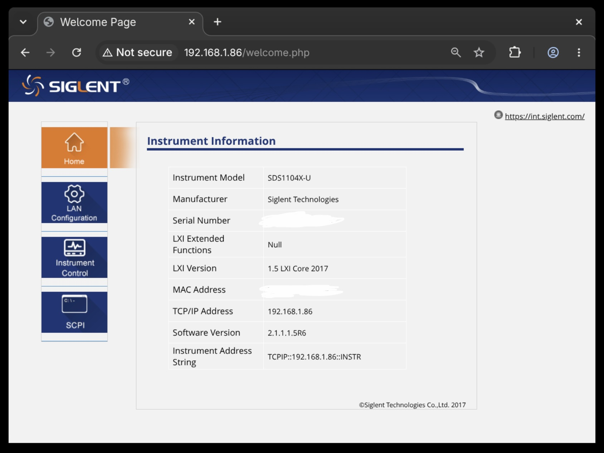
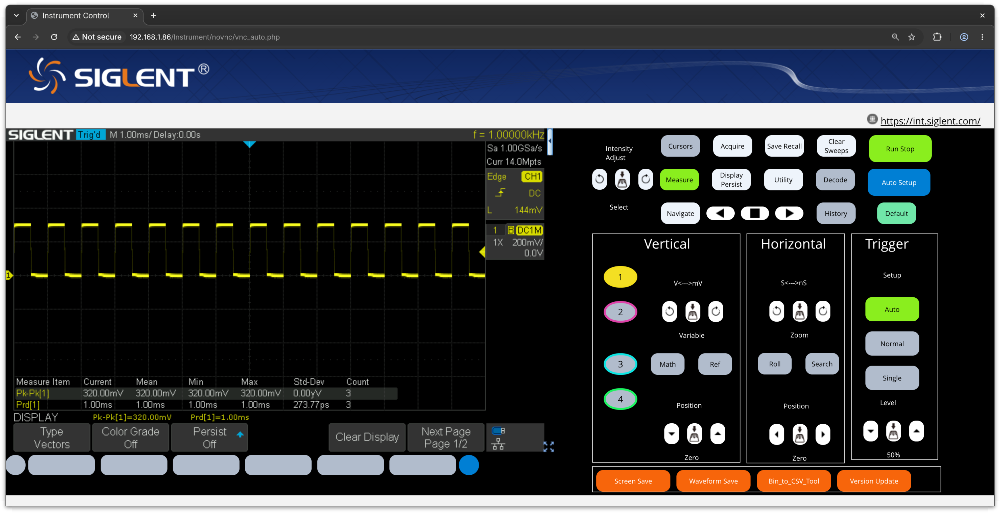

# SDS1104X-U — Root Access via `.ADS` Firmware Update Path

This directory contains everything needed to gain root access on an SDS1104X-U oscilloscope (firmware 1.1.5R6) through the official front-USB `.ADS` firmware update mechanism.

---

## How It Works

The scope boots by running `/etc/init.d/rcS`, which finds a pending firmware upgrade in `/usr/bin/siglent/usr/usr/upgrade/` and executes `update.sh`.

This package replaces `update.sh` inside a custom `.ADS` package. The replacement script:

1. Mounts the USB stick (vfat) at `/tmp/mass_storage/U-disk0`
2. Checks for `usb_script.sh` on the stick
3. Kills `rcS` so it never reaches the hardcoded `reboot -f` — preventing the automatic forced reboot
4. Replicates rcS's normal boot sequence: network config, GPIO, `mdev`, FPGA bitstream load, kernel modules, main scope application (`*.app`), VNC, lighttpd
5. Backs up `update.sh` so it survives `.app` deleting the upgrade folder, then restores it for the next boot
6. Executes `usb_script.sh` from the USB stick, passing the mount path as `$1`
7. If `usb_script.sh` is not found it exits after a 10-second sleep, `rcS` deletes `update.sh` and the scope is rebooted with the stock firmware.

Because `rcS` is killed, the child `usb_script.sh` keeps running.
Telnetd can be started in the `usb_script.sh`.

Booting **without** the USB stick recovers cleanly: rcS finds the upgrade dir, runs `update.sh`, finds no USB, cleans up, reboots normally.

---

## Contents

| File | Purpose |
|------|---------|
| `update.sh` | Custom `update.sh` embedded inside the `.ADS` package |
| `usb_script.sh` | User script on the USB stick — restarts telnetd and lighttpd |
| `README.md` | This file |
| `home_screenshot.jpeg` | Scope home screen screenshot |
| `instrument_control_panel.png` | Instrument control panel screenshot |

---

## Screenshots





---

## `usb_script.sh` — What It Does

This script runs on every boot with the USB stick inserted. It is executed by `update.sh` via:

```sh
sh "$mp/usb_script.sh" "$mp"
```

where `$1` (`$USB_MP`) is the mount path of the USB stick (e.g. `/tmp/mass_storage/U-disk0`).

### Execution Sequence

1. **Checks the mount path exists** — exits if `$USB_MP` is empty or not a directory
2. **Restarts telnetd** — waits for any existing `telnetd` to exit (`while pidof telnetd; do sleep 1; done`), then starts `/bin/busybox telnetd -l /bin/sh &` (since `/usr/sbin/telnetd` is an empty 0-byte stub in the stock firmware; `-l /bin/sh` drops straight to a root shell)
3. **Restarts the web interface** — starts `/usr/sbin/lighttpd -f /etc/lighttpd.conf &`
4. **Placeholder** — `# add your code here` for your custom logic
5. **`sync`** — flushes any writes to the USB stick

### Why `sh` Instead of Direct Execution

FAT32 does not store Unix execute bits. Files on the USB stick appear as `644` (rw-r--r--), so they cannot be executed directly. Using `sh` reads and interprets the script without needing the execute bit.

---

## Generating the `.ADS` Package

### Prerequisites

1. **Original stock `.ADS`** from the vendor website:
   - URL: https://www.siglenteu.com/download/10540/
   - File: `SDS1104X-U_V1.1.5R6.ADS`
   - Save it to: `./SDS1104X-U_V1.1.5R6.ADS`

2. **Build tools** in `../tools/ads/`:
   - `build_surgery_ads.py` — surgical merger script
   - `ads_decode_menu.py` — ADS codec (3DES decryption, header construction)

### The Surgical Merge

The stock `.ADS` contains an inner ZIP with 222 members. Instead of repacking everything (which would change bytes), `build_surgery_ads.py` performs byte surgery:

- Keeps all 221 stock members byte-for-byte identical
- Replaces only `update.sh` with your custom version
- Rebuilds the ZIP central directory and EOCD with corrected offsets
- Re-wraps with the encoder (3DES + check words)

### How to Build

From `firmware/`, run:

```bash
python3 tools/ads/build_surgery_ads.py \
  --stock ./SDS1104X-U_V1.1.5R6.ADS \
  --member update.sh \
  --payload ./update.sh \
  --out out/SDS1104X-U_rcs_takeover_v3.ADS \
  --verify
```

### Verification

The `--verify` flag checks:

- Product ID = 17001
- Header size field matches decoded length
- File check word passes
- Container record check word and length pass
- Member name set identical (222 members)
- Only `update.sh` differs (221/222 byte-identical)
- All ZIP CRCs valid
- Payload round-trips byte-exact

The output `.ADS` is stock-shaped and passes all decoder checks.

---

## Flashing and Using the `.ADS`

### Step 1: Prepare the USB Stick

1. Format a USB stick as FAT32
2. Copy `SDS1104X-U_rcs_takeover_v3.ADS` to the root
3. Copy `usb_script.sh` to the root

### Step 2: Flash the `.ADS`

1. Power on the scope
2. Press **Utility** → **Update** → **Firmware**
3. Select `SDS1104X-U_rcs_takeover_v3.ADS` from the USB stick
4. Confirm the update — the progress bar shows 20% → 80% in ~2 seconds
5. The UI will indicate the update completed

### Step 3: Reboot (Keep USB Inserted)

1. Reboot the scope (or it may prompt you to)
2. **Keep the USB stick inserted**
3. `rcS` runs at boot, finds the upgrade directory, executes `update.sh`
4. `update.sh` mounts the USB, kills `rcS` (no forced reboot), runs the rcS-equivalent boot steps, then executes `usb_script.sh`
5. Telnetd starts on port 23

### Step 4: Connect via Telnet

1. Wait ~30 seconds for DHCP to assign an IP
2. Connect: `telnet <scope-ip> 23`
3. Log in without password

### Step 5: Recovery Without USB

If you boot the scope **without** the USB stick inserted:

1. `rcS` finds the upgrade directory still present
2. Runs `update.sh` again — no USB found, so `usb_script.sh` doesn't execute
3. `rcS` continues: removes the upgrade directory, `reboot -f`
4. Next boot: fully normal stock operation

**You must re-flash the `.ADS` if you want the takeover behavior again.**

---

## Safety Rules

- Never flash a script with an infinite loop or unbounded sleep into `update.sh` — if `rcS` blocks forever, the scope won't boot and you'll need serial access to recover
- This package uses a 10-second hard timeout on `update.sh` (sleep 10, then exit)
- No changes are made to CRAMFS (`mtd5.bin`) except for the upgrade package delivered by `.ADS`
